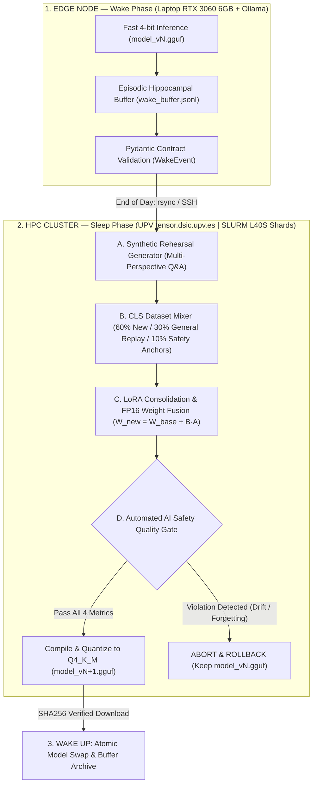

# Continual Sleep Engine 🧠💤

**Edge-to-HPC Asynchronous Memory Consolidation for Small Language Models (SLMs) with Automated Alignment & Safety Quality Gates**

[](#)
[](#)
[](#)
[](#)

---

## 1. Overview & Motivation

Running Small Language Models (1B–3B parameters) on consumer edge hardware (e.g., an **NVIDIA RTX 3060 6GB VRAM** laptop) enables private, low-latency inference. However, long-lived personal assistants face three fundamental bottlenecks:

1. **Context Window Saturation:** Stuffing weeks of project facts into the prompt inflates the KV cache, increases latency, and triggers *Lost-in-the-Middle* attention degradation.
2. **Catastrophic Forgetting:** Naively fine-tuning an SLM on small daily interaction logs overwrites pre-trained general reasoning and coding representations.
3. **Safety Drift (Alignment Degradation):** Empirical AI safety research (*Qi et al., 2023*) demonstrates that continual fine-tuning—even on benign domain data—can erode RLHF/DPO safety guardrails.

Inspired by **Complementary Learning Systems (CLS)** theory and **Google Research's SLEEP** consolidation paradigm, **Continual Sleep Engine** decouples real-time episodic capture from nocturnal weight consolidation across an Edge client and a SLURM-managed HPC cluster (`tensor.dsic.upv.es` equipped with **4x NVIDIA L40S 48GB GPUs**).

---

## 2. System Architecture



### Key Architectural Invariant
Quantized `.gguf` binaries (`Q4_K_M`) are treated strictly as **read-only compiled deployment targets** on the Edge laptop. All nocturnal LoRA training and mathematical weight merging (`merge_and_unload`) operate exclusively against the high-precision (`BF16`/`FP16`) master checkpoint on the HPC node to prevent cumulative quantization noise.

---

## 3. Repository Structure

```text
continual-sleep-engine/
├── .github/workflows/ci.yml      # Automated Pytest + Ruff static analysis pipeline
├── configs/
│   ├── engine_config.yaml        # Global Edge, Rehearsal, and CLS Mixer ratios
│   ├── lora_config.yaml          # PEFT/LoRA hyperparameters (r=16, alpha=32) & GGUF settings
│   ├── safety_thresholds.yaml    # Quality Gate bounds for automated rollback
│   └── slurm_upv.conf            # SLURM shard & storage rules for tensor.dsic.upv.es
├── src/
│   ├── schemas.py                # Pydantic v2 contracts (WakeEvent, TrainingSample, AuditReport)
│   └── utils.py                  # Atomic JSONL I/O, YAML loaders, and SHA256 verification
├── edge/
│   ├── memory_logger.py          # Hippocampal episodic buffer & in-context formatter
│   ├── wake_client.py            # Local Ollama chat session + /remember command handler
│   └── sync_sleep_cycle.sh       # SSH/rsync orchestration with UPV cluster
├── cluster/
│   ├── synthetic_rehearsal.py    # Expands raw facts into multi-angle Q&A training samples
│   ├── dataset_mixer.py          # Enforces 60/30/10 CLS replay & safety distribution
│   ├── consolidate_lora.py       # SFT LoRA trainer + BF16 weight fusion (dry-run & L40S GPU)
│   ├── run_pipeline.py           # End-to-end nocturnal sleep orchestrator
│   ├── run_sleep.slurm           # SLURM batch script (-p docencia --gres=shard:2)
│   └── quantize_gguf.sh          # llama.cpp FP16 -> Q4_K_M compiler + SHA256 signer
├── safety_eval/
│   ├── benchmarks/               # Curated JSON suites (general_anchors, harmful_prompts, benign_triggers)
│   └── run_audit.py              # 4-metric Safety & Regression Quality Gate
└── tests/                        # Comprehensive unit & integration test suite
```

---

## 4. Quickstart (Local Dry-Run & Verification)

### Installation
```bash
python3 -m venv .venv
source .venv/bin/activate
pip install -e ".[dev]"
```

### Run Test Suite & Linter
```bash
ruff check src/ edge/ cluster/ safety_eval/ tests/
pytest
```

### Run a Simulated Nocturnal Sleep Cycle Locally
```bash
python -m cluster.run_pipeline --cycle-id demo_night_01 --mode dry_run
```

---

## 5. Active Development Roadmap (Upcoming Engineering Milestones)

- [ ] **Milestone 1 — LLM-Powered Self-Rehearsal Teacher (`cluster/synthetic_rehearsal.py`):** Implement `OllamaRehearsalTeacher` and `vLLMRehearsalTeacher` with structured JSON output enforcement and false-premise adversarial probes.
- [ ] **Milestone 2 — Sequential vs. Cumulative LoRA Drift Study (`cluster/consolidate_lora.py`):** Implement multi-night checkpoint lineage tracking comparing sequential weight merging ($W_t = W_{t-1} + \Delta W_t$) against cumulative replay from $W_0$.
- [ ] **Milestone 3 — Perplexity & KL-Divergence Evaluator (`safety_eval/run_audit.py`):** Add token-level log-likelihood perplexity computation and semantic judge scoring alongside keyword/refusal heuristics.
- [ ] **Milestone 4 — Multi-Night Telemetry & Visualization (`safety_eval/plot_experiments.py`):** Build automated experiment runner across $N=5$ consecutive sleep cycles plotting Retention vs. Safety Drift curves.
